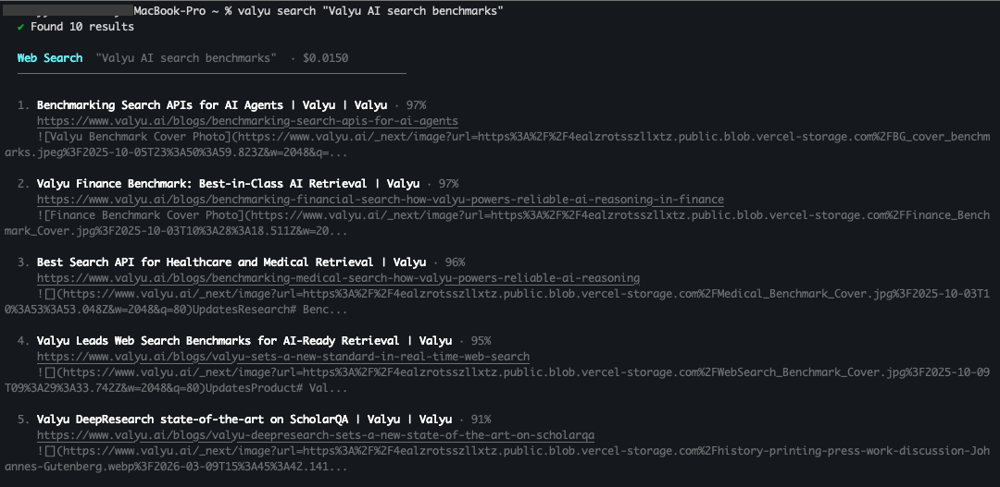

# Valyu CLI

The official CLI for [Valyu](https://valyu.ai).

Built for AI (or human) knowledge workers.

```
  ██╗   ██╗ █████╗ ██╗  ██╗   ██╗██╗   ██╗
  ██║   ██║██╔══██╗██║  ╚██╗ ██╔╝██║   ██║
  ██║   ██║███████║██║   ╚████╔╝ ██║   ██║
  ╚██╗ ██╔╝██╔══██║██║    ╚██╔╝  ██║   ██║
   ╚████╔╝ ██║  ██║███████╗██║   ╚██████╔╝
    ╚═══╝  ╚═╝  ╚═╝╚══════╝╚═╝    ╚═════╝
```

## Install

### cURL (macOS / Linux)

```sh
curl -fsSL https://get.valyu.ai | bash
```

### Node.js

```sh
npm install -g @valyu/cli
```

### Homebrew (macOS / Linux)

```sh
brew install valyuAI/cli/valyu
```

### PowerShell (Windows)

```sh
irm https://get.valyu.ai/install.ps1 | iex
```

Then authenticate:

```bash
valyu login
```

Get your API key at [platform.valyu.ai](https://platform.valyu.ai).

```bash
valyu search "CRISPR base editing latest breakthroughs"
valyu deepresearch create "What drove Tesla's Q4 2024 earnings miss?" --mode instant --watch
valyu sources --category markets
```



---

## Commands

### `valyu search`

Search across web, academic, and proprietary data sources.

```bash
# Web search (default)
valyu search "AI infrastructure investment"

# Specify a source type
valyu search paper "transformer attention mechanisms"
valyu search finance "Apple AAPL earnings Q1 2026"
valyu search bio "CAR-T cell therapy phase 3 trials"
valyu search sec "Tesla 10-K 2024 risk factors"
valyu search patent "mRNA delivery lipid nanoparticles"
valyu search economics "US CPI inflation latest print"
valyu search news "Fed interest rate decision"

# Options
valyu search paper "CRISPR" -n 20          # more results
valyu search finance "MSFT" --json         # pipe-friendly JSON
```

### `valyu answer` (deprecated)

> **Deprecated.** The Answer API is deprecated (announced 2026-11-17) and stops working on **2026-12-17**, when the endpoint returns HTTP 410. `valyu answer` keeps working until then and prints a notice on stderr. Use `valyu deepresearch create "<question>" --mode instant --watch` instead. See the [migration guide](https://docs.valyu.ai/api-reference/endpoint/answer#migrate-from-answer).

```bash
# Replacement
valyu deepresearch create "What is the current state of nuclear fusion commercialisation?" --mode instant --watch
```

### `valyu contents`

Extract clean content from any URL — articles, PDFs, financial reports.

```bash
valyu contents https://example.com/report
valyu contents https://sec.gov/filing --summary
valyu contents https://arxiv.org/abs/2501.00001 --summary "extract methodology and results"
```

### `valyu deepresearch`

Async deep research — produces a full report, like a junior analyst.

```bash
# Start a research task
valyu deepresearch create "Global AI compute infrastructure trends"

# Start and wait for completion
valyu deepresearch create "CRISPR therapeutics market landscape" --mode heavy --watch

# Check on a running task
valyu deepresearch status <task-id>

# Poll until done
valyu deepresearch watch <task-id>
```

#### Edit a finished report

Make small, targeted edits to a finished DeepResearch report or deliverable with a plain-language instruction. Untouched text stays exactly as it was, citations stay consistent, and every edit creates a new version you can restore.

```bash
# Waits for the result and prints the summary, the changes and the new version
valyu deepresearch edit <task-id> "Cut the executive summary to 3 bullets" --section "Executive Summary"

# Limit the edit to a highlighted passage; --strict rejects changes anywhere else
valyu deepresearch edit <task-id> "Soften this claim" --text "Margins will expand by 250 bps." --strict

# Edit a deliverable file instead of the report
valyu deepresearch edit <task-id> "Add a YoY growth % column" --deliverable f_01

# Return straight away, then check on it later
valyu deepresearch edit <task-id> "Fix the Q3 revenue figure" --no-wait
valyu deepresearch edit-status <task-id> <edit-id> --wait

# Version history: list, read an older version, restore one
valyu deepresearch versions <task-id>
valyu deepresearch status <task-id> --version 1
valyu deepresearch restore <task-id> 1
```

Use it to refine a report you already have (fix a figure, tighten a section, change tone, add a cited point from the sources the task gathered) instead of running new research. Large rewrites are declined; start a new task for those. `edit` exits with 0 when the edit is applied (or nothing needed changing), 2 when it is declined and 1 on failure.

Research modes:

| Mode       | Time       | Use for                          |
|------------|------------|----------------------------------|
| `instant`  | under 30 s | Quick answers, compact report    |
| `fast`     | ~5 min     | Quick lookups, simple questions  |
| `standard` | ~10-20 min | Balanced research (default)      |
| `heavy`    | ~60 min    | In-depth analysis, long reports  |
| `max`      | up to ~2 hrs | Maximum depth and quality      |

`instant` does not support HITL checkpoints and is not available for batches.

### `valyu workflows`

Reusable, versioned deep research templates. A workflow bundles a prompt, research
strategy, report format, deliverables, and recommended mode with typed `{variables}`.
Fill in the variables and run it - the template expands into a normal deep research task.

Curated Valyu workflows (e.g. an IC memo, a drug competitive landscape, a company
profile) are available to everyone; workflows you create are private to your org.

```bash
# Browse curated templates
valyu workflows list --scope valyu
valyu workflows list --vertical investment-banking

# Inspect a template and its variables
valyu workflows get ib-company-profile

# Preview the resolved prompt without spending credits
valyu workflows preview ib-company-profile --param company="NVIDIA (NVDA)"

# Run it (starts a deep research task)
valyu workflows run ib-company-profile --param company="NVIDIA (NVDA)" --watch
valyu workflows run ib-company-profile -P company="Apple" -m heavy

# Manage your own org workflows
valyu workflows create --file workflow.json
valyu workflows update my-flow --file patch.json
valyu workflows delete my-flow
```

### `valyu sources`

Browse all available data sources with pricing.

```bash
valyu sources                          # all 36+ sources
valyu sources --category markets       # financial data only
valyu sources --category research      # academic sources
```

### Other commands

```bash
valyu login              # save API key
valyu logout             # remove saved key
valyu whoami             # show active key and profile
valyu doctor             # check setup and connectivity
valyu open               # open platform, docs, or API keys in browser
```

---

## Flags

| Flag | Description |
|------|-------------|
| `--api-key <key>` | Override stored key for one request |
| `--json` | Force JSON output (for scripting/pipes) |
| `-q, --quiet` | No spinners, just JSON (implies `--json`) |
| `-p, --profile <name>` | Use a named credential profile |

---

## Scripting and agents

Every command outputs clean JSON with `--json` or in non-TTY contexts:

```bash
# Pipe into jq
valyu search finance "AAPL" --json | jq '.results[].title'

# In CI/CD
RESULTS=$(valyu deepresearch create "latest rate decision" --mode instant --watch --quiet)

# With environment variable
VALYU_API_KEY=your_key valyu search web "query" --json
```

> **Key precedence:** `--api-key` flag → your `valyu login` key → `VALYU_API_KEY`. A logged-in
> key takes precedence over the env var, so you don't need to unset `VALYU_API_KEY` after
> running `valyu login`. `VALYU_API_KEY` still applies when you haven't logged in (e.g. CI).

### Multiple profiles

```bash
valyu login --profile work
valyu login --profile personal
valyu search web "query" --profile work
```

---

## Agent skill

The CLI ships with a SKILL.md file that teaches AI coding agents how to use it - no MCP server needed, 4-32x cheaper in tokens.

```
npx skills add @valyu/cli
```

Then agents can call:

```
Valyu(search, "CRISPR base editing")
Valyu(deepresearch create, "What drove NVDA earnings?" --mode instant --watch)
Valyu(contents, "https://example.com")
```

---

## Data sources

36+ proprietary and public data sources across:

- **Web** - real-time web search
- **Academic** - arXiv, PubMed, bioRxiv, medRxiv
- **Financial** - stocks, earnings, balance sheets, cash flows, crypto, forex
- **SEC** - 10-K, 10-Q, 8-K filings full text
- **Patents** - global patent databases
- **Biomedical** - clinical trials, FDA drug labels, ChEMBL, DrugBank
- **Economic** - BLS, FRED, World Bank, USASpending

See all: `valyu sources`

---

## Links

- [Platform](https://platform.valyu.ai) — manage keys, usage, billing
- [Docs](https://docs.valyu.ai) — API reference
- [npm](https://www.npmjs.com/package/@valyu/cli)

---

## License

MIT
