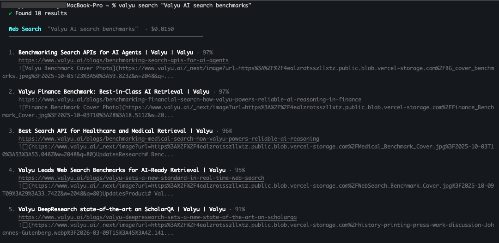

# Valyu CLI

The official CLI for [Valyu](https://valyu.ai).

Built for AI (or human) knowledge workers.

```
  ██╗   ██╗ █████╗ ██╗  ██╗   ██╗██╗   ██╗
  ██║   ██║██╔══██╗██║  ╚██╗ ██╔╝██║   ██║
  ██║   ██║███████║██║   ╚████╔╝ ██║   ██║
  ╚██╗ ██╔╝██╔══██║██║    ╚██╔╝  ██║   ██║
   ╚████╔╝ ██║  ██║███████╗██║   ╚██████╔╝
    ╚═══╝  ╚═╝  ╚═╝╚══════╝╚═╝    ╚═════╝
```

## Install

### cURL (macOS / Linux)

```sh
curl -fsSL https://get.valyu.ai | bash
```

### Node.js

```sh
npm install -g @valyu/cli
```

### Homebrew (macOS / Linux)

```sh
brew install valyuAI/cli/valyu
```

### PowerShell (Windows)

```sh
irm https://get.valyu.ai/install.ps1 | iex
```

Then authenticate:

```bash
valyu login
```

Get your API key at [platform.valyu.ai](https://platform.valyu.ai).

```bash
valyu search "CRISPR base editing latest breakthroughs"
valyu sources "SEC filings"
valyu contents https://example.com/report --summary
```



---

## Commands

Four commands do the work: `search`, `sources`, `contents` and `deepresearch`.

### `valyu search`

One search across the live web and specialised datasets - academic papers (including licensed journals), SEC filings, company fundamentals, market data, clinical trials, drug labels, economic series, patents, case law and news. Routing is automatic, so a plain query is the right call for nearly every question.

```bash
valyu search "AI infrastructure investment"
valyu search "GLP-1 receptor agonists cardiovascular outcomes" -n 20
valyu search "US CPI inflation latest"
```

Scope only when you need a specific source. Dataset ids come from `valyu sources`; domains, URL prefixes and presets (`academic`, `finance`, `legal`, ...) work too:

```bash
valyu search "Apple 10-K Item 1A risk factors" --include-source valyu/valyu-sec-filings
valyu search "rotary position embeddings" --include-source arxiv.org
valyu search "quantum error correction" --source-bias arxiv.org=3 --source-bias reddit.com=-4
valyu search "EU AI Act enforcement" --start-date 2026-01-01
```

`-l, --response-length` sets the characters returned per result (default 4000).

### `valyu sources`

Find the dataset to scope a search to. Describe the data you need, or list the whole catalog; datasets outside your plan are marked.

```bash
valyu sources "peer-reviewed medical literature"
valyu sources "insider transactions"
valyu sources
valyu sources --category healthcare
```

### `valyu contents`

Read any URL as clean markdown - articles, PDFs, filings, JS-heavy pages.

```bash
valyu contents https://example.com/report
valyu contents https://sec.gov/filing --summary
valyu contents https://arxiv.org/abs/2501.00001 --summary "extract methodology and results"
valyu contents https://dashboard.example.com --extract-effort high --screenshot
```

### `valyu deepresearch`

Asynchronous deep research: an agent plans, searches, reads and writes a full cited report, optionally with CSV / XLSX / PPTX / DOCX / PDF deliverables.

```bash
# Start a task (returns an id at once)
valyu deepresearch create "Global AI compute infrastructure trends"

# Start and wait for the report
valyu deepresearch create "CRISPR therapeutics market landscape" --mode heavy --watch

# Check on it - the full report once it completes
valyu deepresearch status <task-id>

# Redirect it, answer a checkpoint, share or cancel it
valyu deepresearch steer <task-id> "Also cover EU regulation"
valyu deepresearch respond <task-id> --approve
valyu deepresearch share <task-id>
valyu deepresearch cancel <task-id>

# Run a saved research template
valyu deepresearch create --workflow ib-company-profile -P company="NVIDIA (NVDA)"
```

Research modes:

| Mode       | Time           | Price  | Use for                               |
|------------|----------------|--------|---------------------------------------|
| `fast`     | ~8-12 min      | $0.10  | A focused, cited answer (default)     |
| `standard` | ~10-20 min     | $0.50  | A broader sweep, more sources         |
| `heavy`    | up to ~90 min  | $2.50  | A deep multi-angle investigation      |
| `max`      | up to ~3 hrs   | $15.00 | Exhaustive research                   |

### Other commands

```bash
valyu login              # save API key
valyu logout             # remove saved key
valyu whoami             # show active key and profile
valyu account            # keys, budget caps, balance, top-ups
valyu doctor             # check setup and connectivity
valyu open               # open platform, docs, or API keys in browser
```

---

## Flags

| Flag | Description |
|------|-------------|
| `--api-key <key>` | Override stored key for one request |
| `--json` | Force JSON output (for scripting/pipes) |
| `-q, --quiet` | No spinners, just JSON (implies `--json`) |
| `-p, --profile <name>` | Use a named credential profile |

---

## Scripting and agents

Every command outputs clean JSON with `--json` or in non-TTY contexts, and reads its query or URLs from stdin:

```bash
# Pipe into jq
valyu search "Apple AAPL earnings" --json | jq '.results[].title'

# Chain commands
valyu search "EU AI Act guidance" -q | jq -r '.results[:3][].url' | valyu contents --summary -q

# In CI/CD
echo "latest Fed rate decision" | VALYU_API_KEY=your_key valyu search --quiet
```

Search and contents add a `hint` field when results need explaining (a backend failed, nothing matched, results were trimmed). Errors go to stderr as `{"error":{"message","code"}}` with exit code 1.

> **Key precedence:** `--api-key` flag → your `valyu login` key → `VALYU_API_KEY`. A logged-in
> key takes precedence over the env var, so you don't need to unset `VALYU_API_KEY` after
> running `valyu login`. `VALYU_API_KEY` still applies when you haven't logged in (e.g. CI).

### Multiple profiles

```bash
valyu login --profile work
valyu login --profile personal
valyu search "query" --profile work
```

---

## Agent skill

The CLI ships with a SKILL.md file that teaches AI coding agents how to use it - no MCP server needed, 4-32x cheaper in tokens.

```
npx skills add @valyu/cli
```

It teaches agents to search unscoped by default, look up dataset ids with `valyu sources` before scoping, read URLs with `valyu contents`, and start deep research only when it was asked for.

---

## Data sources

The live web plus specialised datasets across:

- **Academic** - arXiv, PubMed, bioRxiv, medRxiv and licensed journals
- **Company & markets** - SEC filings, fundamentals, insider transactions, stocks, crypto, forex
- **Healthcare** - clinical trials, FDA drug labels, ChEMBL, PubChem, Open Targets
- **Economic** - BLS, FRED, World Bank, IMF
- **Patents** - US and European patents
- **Legal & politics** - UK case law, legislation and Parliament
- **Cybersecurity** - CVEs, CISA KEV, MITRE ATT&CK
- **News & predictions** - AP and financial news, prediction markets

See the live catalog: `valyu sources`

---

## Links

- [Platform](https://platform.valyu.ai) — manage keys, usage, billing
- [Docs](https://docs.valyu.ai) — API reference
- [npm](https://www.npmjs.com/package/@valyu/cli)

---

## License

MIT
